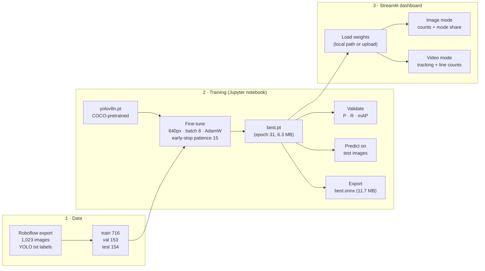
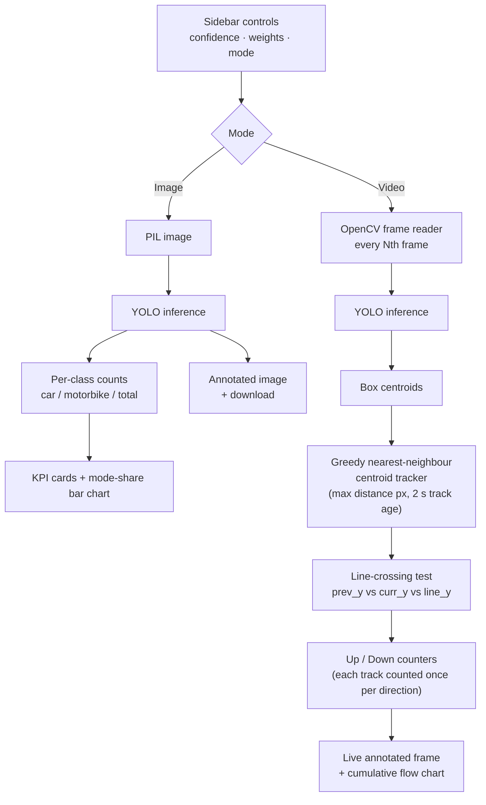
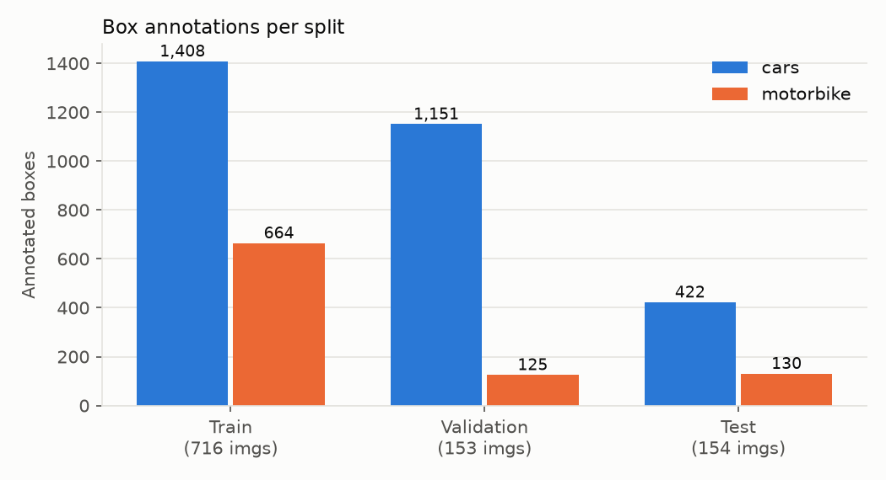
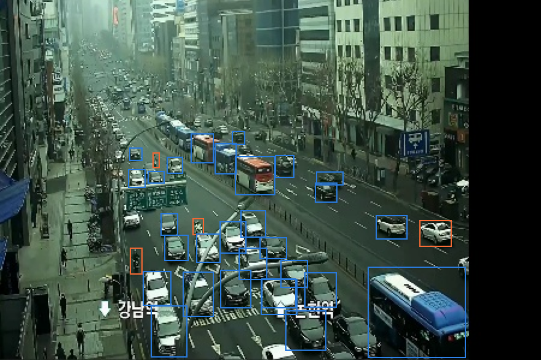
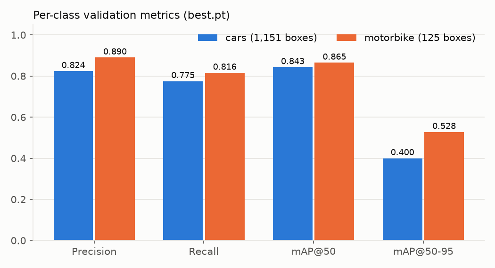
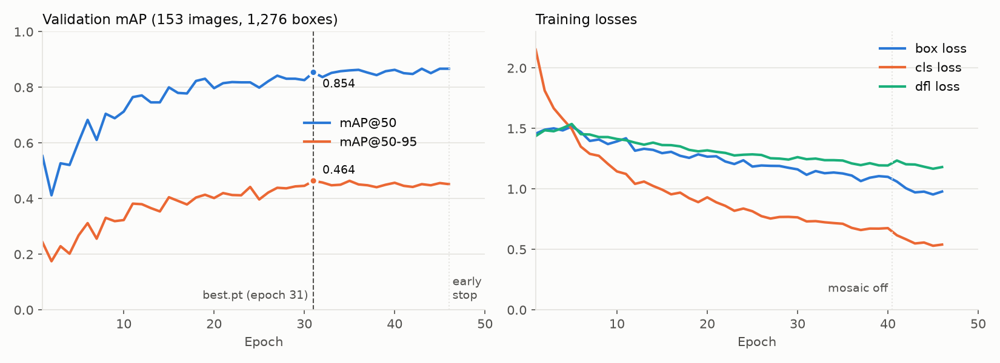
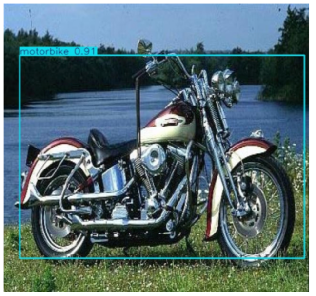
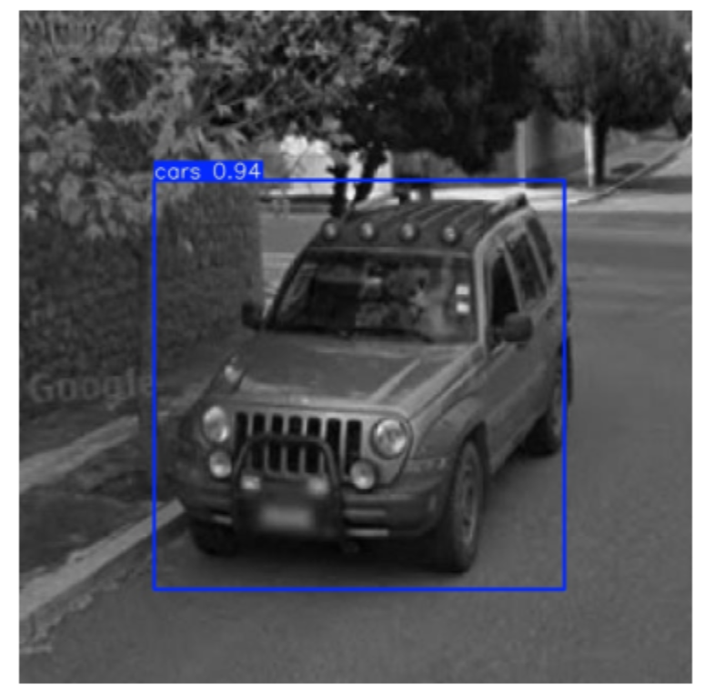
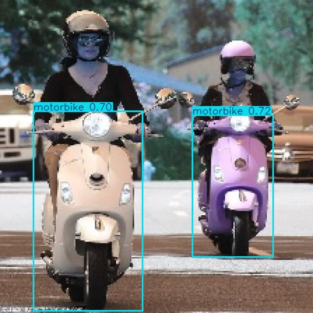
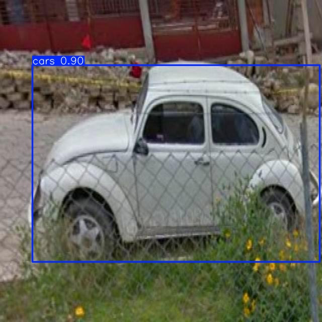

# YOLOv8 Vehicle Detection System for Urban Mobility Planning

Fine-tuned **YOLOv8n** detector for **cars and motorbikes** in road and CCTV imagery, plus a **Streamlit dashboard** that turns detections into traffic-planning indicators: vehicle counts, car/motorbike mode share, and directional line-crossing counts from video.

> Group 01 assignment, **AMCS 6203 – Machine Learning Theories and Applications** (MSc Data Science & AI, NM-AIST), submitted April 2026.

| | |
|---|---|
| **Task** | 2-class object detection (`cars`, `motorbike`) |
| **Model** | YOLOv8n (nano), COCO-pretrained, fine-tuned: 3.0 M params, 8.1 GFLOPs |
| **Data** | 1,023 Roboflow-annotated images (716 train / 153 val / 154 test) |
| **Best result (validation)** | **mAP@50 0.854 · mAP@50-95 0.464 · Precision 0.857 · Recall 0.796** |
| **Deployment** | Streamlit web app (image + video modes), ONNX export |

---

## Contents

1. [Problem](#1-problem)
2. [System architecture](#2-system-architecture)
3. [Dataset](#3-dataset)
4. [Methodology](#4-methodology)
5. [Results](#5-results)
6. [Dashboard](#6-streamlit-dashboard)
7. [Project status: completed vs ongoing](#7-project-status-completed-vs-ongoing)
8. [Getting started](#8-getting-started)
9. [Repository layout](#9-repository-layout)
10. [Technologies](#10-technologies)
11. [Team & contribution](#11-team--contribution)

---

## 1. Problem

Most roads in Tanzania have no automated traffic-monitoring infrastructure: no inductive loops, no counting sensors, no automated detection. Traffic data is collected by hand, which is slow, expensive and too sparse for evidence-based urban planning.

CCTV and phone cameras are already common, though. This project asks:

> *Can a small, CPU-friendly deep-learning detector, fine-tuned on under 1,000 images, reliably detect cars and motorbikes and turn those detections into planning indicators such as vehicle counts, mode share and directional flow?*

Motorbikes (including *bodaboda* taxis) are a large share of urban traffic in East Africa and are often missed by generic counting setups. For that reason the model is trained to tell **cars** and **motorbikes** apart rather than detect a single "vehicle" class.

## 2. System architecture

### End-to-end pipeline



### Dashboard internals ([dashboard.py](dashboard.py))



The video counter is a lightweight, dependency-free tracker written for this project (`_match_tracks` in [dashboard.py](dashboard.py)):

1. Each detection is reduced to its box centroid.
2. Existing tracks are matched to the nearest unused centroid (greedy) if it lies within the **match distance** slider value. Unmatched detections start new tracks, and tracks unseen for about 2 s (`2 × fps` frames) are dropped.
3. A vehicle counts as **Down** when its centroid moves from above to on or below the user-placed horizontal counting line, and as **Up** for the reverse. Flags on each track stop it from being counted twice in the same direction.

## 3. Dataset

Source: a private Roboflow workspace (`cctv_car_bike_detection`), exported in YOLOv8 format on 15 April 2026. **No pre-processing or augmentation** was applied at export; augmentation happens online during training (mosaic, HSV jitter, flips, scale/translate, random erasing).

| Split | Images | `cars` boxes | `motorbike` boxes | CCTV frames |
|---|---:|---:|---:|---:|
| Train | 716 | 1,408 | 664 | 59 |
| Validation | 153 | 1,151 | 125 | 52 |
| Test | 154 | 422 | 130 | 18 |
| **Total** | **1,023** | **2,981** | **919** | **129** |

<p align="center"></p>

Two things to note about the data:

- **Mixed domains.** Most images are single-object close-ups (one car or one motorbike filling the frame). A minority are dense, elevated **CCTV street frames** with 10–60 vehicles each. The validation split is much more CCTV-heavy (34% of images) than the training split (8%), so validation results are weighted towards the harder, denser domain.
- **Label noise.** Some CCTV frames label buses as `cars`, and at least one car is labelled `motorbike` (the orange box on the right below).

<p align="center"><br><em>Ground-truth annotations on a validation CCTV frame (blue = <code>cars</code>, orange = <code>motorbike</code>).</em></p>

Label format (one line per object, coordinates normalised to [0, 1]):

```
<class_id> <x_center> <y_center> <width> <height>      # 0 = cars, 1 = motorbike
```

## 4. Methodology

1. **Transfer learning.** Start from `yolov8n.pt` (COCO, 80 classes, which already include *car* and *motorcycle*). Replace the detection head with a 2-class head (`nc=80 → 2`); 319 of 355 weight tensors transfer.
2. **Fine-tuning** ([Group_01_Assigment.ipynb](Group_01_Assigment.ipynb)):

   | Hyper-parameter | Value |
   |---|---|
   | Image size | 640 × 640 |
   | Epochs | 50 (early stopping, patience 15) |
   | Batch size | 8 |
   | Optimizer | `auto` → **AdamW**, lr 0.001667, momentum 0.9, weight decay 5e-4 |
   | Warm-up | 3 epochs |
   | Augmentation | Ultralytics defaults: mosaic (disabled last 10 epochs), HSV, flip-LR 0.5, scale 0.5, translate 0.1, erasing 0.4 |
   | Hardware | Apple M2, **CPU only** (Ultralytics 8.4.37, PyTorch 2.11) |

3. **Model selection.** Ultralytics keeps the checkpoint with the best validation fitness (weighted towards mAP@50-95) as `best.pt`. Training stopped early after **46 epochs (3.6 h)**; the best epoch was **31**.
4. **Evaluation.** Precision, recall, mAP@50 and mAP@50-95 on the validation split, overall and per class.
5. **Inference & export.** Batch prediction over the 154 test images (`conf=0.25`), then export to **ONNX** for deployment outside PyTorch.
6. **Application layer.** Streamlit dashboard for image and video inference with traffic-counting logic ([section 6](#6-streamlit-dashboard)).

## 5. Results

### 5.1 Headline metrics (`best.pt`, validation set: 153 images, 1,276 boxes)

| Class | Images | Boxes | Precision | Recall | mAP@50 | mAP@50-95 |
|---|---:|---:|---:|---:|---:|---:|
| **All** | 153 | 1,276 | **0.857** | **0.796** | **0.854** | **0.464** |
| cars | 88 | 1,151 | 0.824 | 0.775 | 0.843 | 0.400 |
| motorbike | 86 | 125 | 0.890 | 0.816 | 0.865 | 0.528 |

<p align="center"></p>

### 5.2 Training dynamics

<p align="center"></p>

- mAP@50 rose from 0.55 (epoch 1) to 0.854 (epoch 31) and then levelled off at 0.84–0.87. mAP@50-95 peaked at 0.464.
- The training losses keep falling after epoch 31 (and drop more sharply once mosaic is switched off at epoch 41), but validation mAP@50-95 does not improve. That is an early sign of over-fitting to the small training set.

### 5.3 Efficiency

| Measure | Value |
|---|---|
| Parameters / compute (fused) | 3.0 M params, 8.1 GFLOPs |
| `best.pt` size | 6.3 MB |
| `best.onnx` size | 11.7 MB |
| CPU inference, single image, 448×640 (Apple M2) | **≈ 89 ms/image** (≈ 11 FPS) with 1.9 ms pre- + 0.9 ms post-processing |
| CPU inference during validation, 640×640 batches | ≈ 204–219 ms/image |
| Training time | 3.6 h for 46 epochs on CPU |

### 5.4 Interpretation

- **Cars are the harder class, despite having more labels.** Car mAP@50-95 is 0.400 against 0.528 for motorbikes. Most validation cars sit in dense CCTV frames (1,151 boxes across 88 images): small, far away, partly hidden, and mixed with buses labelled as cars. Most validation motorbikes are large single-object images.
- **The gap between mAP@50 and mAP@50-95** (0.854 vs 0.464) shows the model usually *finds* vehicles but its boxes are less tight. That is expected for a nano model on small objects.
- **Recall (0.796) is the weakest metric.** About one in five ground-truth vehicles is missed, mostly small or occluded cars in CCTV frames.

### 5.5 Qualitative results (test images)

| | |
|:-:|:-:|
|  |  |
|  |  |

*Predictions from `best.pt` at `conf=0.25`: a motorbike (0.91), a car on a street (0.94), two scooters (0.70 / 0.72) and a car partly hidden by a fence (0.90).* On the 18 dense CCTV test frames the model returns 11–60 car detections per frame (see the notebook output).

## 6. Streamlit dashboard

Run `streamlit run dashboard.py` (setup in [section 8](#8-getting-started)).

| Feature | Image mode | Video mode |
|---|:-:|:-:|
| Confidence-threshold slider | ✅ | ✅ |
| Load weights from local path **or** upload a `.pt` file | ✅ | ✅ |
| Side-by-side original / annotated view | ✅ | – |
| KPI cards: cars, motorbikes, total objects | ✅ | – |
| Mode-share bar chart (car vs motorbike) | ✅ | – |
| Download annotated image | ✅ | – |
| Adjustable counting line (height %) | – | ✅ |
| Frame-skip ("speed") control | – | ✅ |
| Tracker match-distance control | – | ✅ |
| Live Up / Down crossing counts + cumulative flow chart | – | ✅ |

> 📸 **Dashboard screenshots:** not in the repository yet; see [section 7](#7-project-status-completed-vs-ongoing). The trained weights (`best.pt`) are also not committed, so the app needs a weights file before it can run.

## 7. Project status: completed vs ongoing

### ✅ Completed and verified (results in the notebook outputs)

- [x] Dataset sourced, annotated in YOLO format and split 70/15/15 (1,023 images).
- [x] YOLOv8n fine-tuned for 46 epochs with early stopping; best checkpoint at epoch 31.
- [x] Validation evaluation: overall and per-class P / R / mAP@50 / mAP@50-95 (the numbers in [section 5](#5-results)).
- [x] Batch inference on all 154 test images; annotated predictions saved.
- [x] ONNX export of the best model.
- [x] Streamlit dashboard: image-mode counts and mode share, video-mode centroid tracking with directional line-crossing counts.
- [x] Colour-channel fix in the dashboard: annotated images are displayed as BGR, and video frames go to the model in the BGR order it expects (previously red/blue were swapped on screen and in the model's input).
- [x] Written report ([PDF](Group%2001%20Object%20Detection%20Report.pdf)) and presentation ([PPTX](Group%2001%20Object%20detection%20PPT.pptx)).

### 🧪 Ongoing / experimental: not yet validated

| Item | Current state | Next step |
|---|---|---|
| **Held-out test metrics** | Reported metrics are on the **validation** split, which was also used for early stopping and checkpoint selection, so they are likely somewhat optimistic. The test split has only been run through `predict()`. | Run `model.val(split="test")` and report test-set P / R / mAP. |
| **Video counting accuracy** | The tracker and line counter work as a demo but have **not been compared with manually counted ground truth**. Greedy centroid matching can swap IDs in dense traffic. Counts cover all classes combined, not per class. | Hand-count a few reference clips and report counting error; try ByteTrack / BoT-SORT (built into Ultralytics); split counts by class. |
| **Flow time series** | The flow chart bins on *processing wall-clock time*, not video timestamps, so the x-axis depends on hardware speed. | Bin on `frame_idx / fps`. |
| **Planning insights** | `_planning_insights()` is a stub (it returns nothing when vehicles are detected) and is not called. The vehicle-density (veh/m²) calculation is commented out because no camera calibration is available. | Finish rule-based insights; add an optional metres-per-pixel calibration input. |
| **Report features not yet in code** | The report and slides mention a per-detection summary table (class, confidence, box) and WEBP upload. The current `dashboard.py` shows aggregate KPI cards and accepts JPG/PNG/JPEG only. | Add an `st.dataframe` of per-box results; accept `webp`. |
| **Model scaling & data** | Only YOLOv8n has been trained. | Try YOLOv8s/m, more CCTV and night/rain data, clean CCTV labels (buses), add `bus` / `truck` / `bicycle` classes. |
| **GIS integration** | Idea stage (in the slides). | City-wide heat-maps from geotagged camera counts. |

## 8. Getting started

### Prerequisites

- Python 3.10+ (the code uses `X | None` type hints)
- About 1 GB of disk space for dependencies and the unpacked dataset

```bash
pip install -r requirements.txt
```

### 8.1 Prepare the dataset

Each zip contains its images under `train/images` and `train/labels`, whatever split it is. Unpack them into the layout the notebook expects:

```bash
mkdir -p cctv_car_motorbike_detection/{images,labels}/{train,val,test} _tmp
for pair in "TRAINING:train" "VALIDATION:val" "TEST:test"; do
  src=${pair%%:*}; dst=${pair##*:}
  rm -rf _tmp/* && unzip -q "cctv_car_bike_detection.yolov8 ($src).zip" -d _tmp
  mv _tmp/train/images/* cctv_car_motorbike_detection/images/$dst/
  mv _tmp/train/labels/* cctv_car_motorbike_detection/labels/$dst/
done
rm -rf _tmp
```

### 8.2 Train, evaluate and export

Open [Group_01_Assigment.ipynb](Group_01_Assigment.ipynb) and run all cells, or use the CLI equivalent:

```bash
yolo detect train data=cctv_car_motorbike_detection/data.yaml model=yolov8n.pt epochs=50 imgsz=640 batch=8 patience=15 name=car_motorbike_detection
yolo detect val   model=runs/detect/car_motorbike_detection/weights/best.pt data=cctv_car_motorbike_detection/data.yaml
yolo detect val   model=runs/detect/car_motorbike_detection/weights/best.pt data=cctv_car_motorbike_detection/data.yaml split=test   # held-out test metrics
yolo export       model=runs/detect/car_motorbike_detection/weights/best.pt format=onnx
```

The notebook writes `data.yaml` for you. Add `device=0` (CUDA) or `device=mps` (Apple Silicon) for much faster training than the CPU run reported here.

### 8.3 Run the dashboard

```bash
cp runs/detect/car_motorbike_detection/weights/best.pt .
streamlit run dashboard.py
```

Then, in the sidebar, either keep the default path `best.pt` or choose **Upload .pt weights**, pick **Image** or **Video** mode, and upload a file.

## 9. Repository layout

```
.
├── Group_01_Assigment.ipynb                     # Training, validation, inference, ONNX export (with outputs)
├── dashboard.py                                 # Streamlit app: image counts + video tracking/line counting
├── requirements.txt                             # Python dependencies
├── cctv_car_bike_detection.yolov8 (TRAINING).zip    # 716 images + YOLO labels
├── cctv_car_bike_detection.yolov8 (VALIDATION).zip  # 153 images + YOLO labels
├── cctv_car_bike_detection.yolov8 (TEST).zip        # 154 images + YOLO labels
├── Group 01 Object Detection Report.pdf         # 8-page written report
├── Group 01 Object detection PPT.pptx           # 10-slide presentation
└── docs/images/                                 # Figures used in this README
```

## 10. Technologies

| Layer | Tools |
|---|---|
| Detection model | **Ultralytics YOLOv8** (v8.4.37) on **PyTorch** 2.11 |
| Data annotation & management | **Roboflow** |
| Experimentation | Jupyter Notebook, Matplotlib, PyYAML |
| Application | **Streamlit**, OpenCV, Pillow, NumPy, pandas |
| Deployment format | PyTorch `.pt`, **ONNX** (opset 20) |

## 11. Team & contribution

**Group 01:** Allen Lyimo (M026/T25) · Cleverfred Mhidze (M069/T25) · Frank Mtibili (M047/T25)

What this project adds on top of the off-the-shelf YOLOv8 tooling:

- **A task-specific dataset:** 1,023 images annotated for a car vs motorbike split that matters in East African traffic, mixing close-up and dense CCTV scenes.
- **A fine-tuned, CPU-deployable detector:** 0.854 mAP@50 at 3 M parameters and about 89 ms per image on a laptop CPU, trained without a GPU.
- **A planning-oriented application layer:** a custom centroid tracker and directional line-crossing counter, plus mode-share and count summaries. These turn raw boxes into numbers a traffic planner can use.
- **An honest evaluation:** per-class analysis, training-dynamics analysis, and the open issues listed in [section 7](#7-project-status-completed-vs-ongoing).

---

<sub>Academic coursework project. The dataset is from a private Roboflow workspace; check with the authors before reusing it.</sub>
